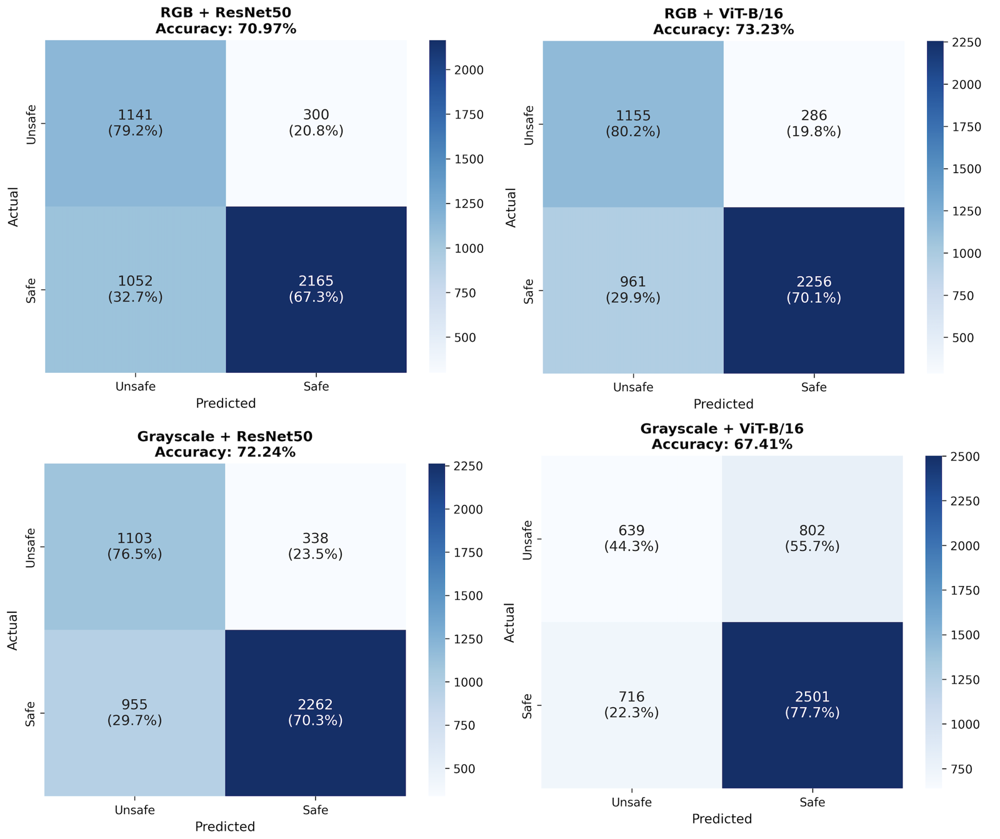
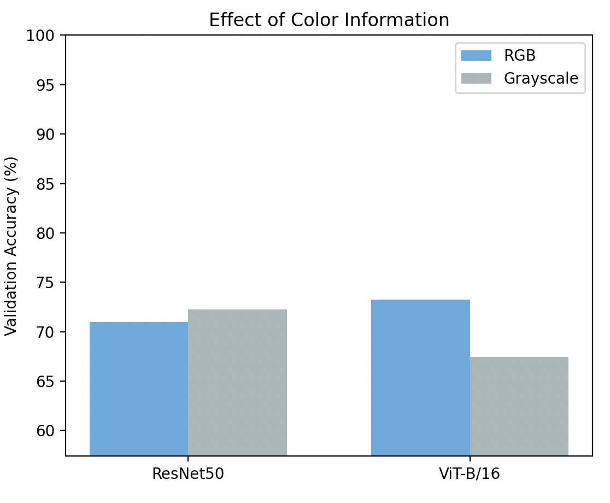
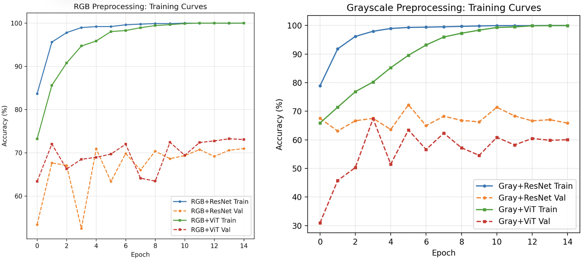

# Urban Safety Perception from Street-View Images

Does color matter when a model judges whether a street looks safe, and do Vision Transformers beat CNNs at it? This project fine-tunes ResNet50 and ViT-B/16 on RGB and grayscale versions of MIT Place Pulse 2.0 images and compares all four combinations.

**Report:** [docs/report.pdf](docs/report.pdf) · **Course:** CS 5785 Applied Machine Learning, Cornell Tech, Fall 2025 · **Author:** Jacey Hu

---

## Results

| Configuration | Validation accuracy |
|---|---|
| RGB + ResNet50 | 70.97% |
| **RGB + ViT-B/16** | **73.23%** |
| Grayscale + ResNet50 | 72.24% |
| Grayscale + ViT-B/16 | 67.41% |



What the four runs show on this split:

- **Color helps a little on average.** RGB averages 72.10% and grayscale 69.83%, a +2.28 point difference.
- **ResNet50 edges out ViT on average** (71.61% vs 70.32%), even though ViT gets the single best score.
- **The architectures respond differently to color.** ResNet50 does slightly *better* without color (70.97% → 72.24%). ViT drops 5.82 points (73.23% → 67.41%), which suggests it relies more on color cues.



## How it works

1. **Labels.** Place Pulse 2.0 turns pairwise "which looks safer?" votes into TrueSkill scores. For each `place_id` the script keeps the highest-vote score (places with more than 5 votes). Places below *mean − 1.5 SD* are labeled **unsafe**, places above *mean + 1.5 SD* are labeled **safe**, and the rest are dropped. That leaves 7 places.
2. **Images.** Each labeled place expands to every photo taken there (via `locations.tsv`), giving 11,296 images (47.8% unsafe, 52.2% safe). Every image inherits its place's label.
3. **Split.** `GroupShuffleSplit` by `place_id` (80/20), so no place appears in both sets: 5 places for training, 2 for validation.
4. **Preprocessing.** 224×224, ImageNet normalization. Grayscale images are replicated to 3 channels so pretrained weights still fit. Training augmentation: horizontal flip, plus brightness/contrast jitter for RGB. No vertical flips or rotations, since those make unrealistic street scenes.
5. **Models.** ImageNet-pretrained ResNet50 (torchvision, 23.5M parameters) and ViT-B/16 (timm, 86M parameters), each with a 2-class head.
6. **Training.** 15 epochs, AdamW (lr 1e-4, weight decay 0.01), cosine annealing, batch size 32, cross-entropy loss. The checkpoint with the best validation accuracy is kept. About 2.5 hours for all four runs on an Apple M4 (MPS).

## Limitations

These matter for how far the numbers above can be trusted, so they are worth reading before reusing the results.

- **Labels are assigned per place, not per image.** Each place gets one label from one TrueSkill score, and every photo at that place inherits it. With only 7 places, the models can learn what a place looks like (architecture, vegetation, road style) rather than which visual cues make a street feel safe.
- **Validation is two places, one of each class.** Because labels are per place, the 2 held-out places must be one unsafe place (1,441 images) and one safe place (3,217 images). Accuracy therefore measures how well the model tells those two places apart, and it could change a lot with a different split.
- **No separate test set.** The best epoch is chosen on the same validation set that is reported, so the accuracies are optimistic.
- **Strong overfitting.** Training accuracy reaches ~100% within a few epochs while validation loss rises from epoch 1–2 (see below).
- **Binary labels** simplify what is really a continuous perception score.



**What I would change next:** label each image by its own location's TrueSkill score instead of its place's, use many more places, hold out a separate test set of places, and report results across several random splits. Semantic segmentation (sky, greenery, buildings) and attention maps would then help explain *which* features drive the predictions.

## Repository structure

```
├── run_experiments.py          # entry point: data prep → training → results → figures
├── safety_perception/
│   ├── config.py               # hyperparameters and experiment list
│   ├── data.py                 # labels, image lookup, place-based split, Dataset/transforms
│   ├── models.py               # ResNet50 and ViT-B/16 builders
│   ├── train.py                # training loop with best-checkpoint saving
│   ├── evaluate.py             # predictions and error indices
│   └── plots.py                # confusion matrices, curves, error examples
├── data/README.md              # how to get Place Pulse 2.0
├── results/report_results.csv  # numbers reported in the paper
└── docs/                       # report and README figures
```

## Setup and usage

```bash
pip install -r requirements.txt
```

Download Place Pulse 2.0 as described in [data/README.md](data/README.md), then:

```bash
# all four experiments (as in the report)
python run_experiments.py --data-path data/place-pulse-2.0

# one experiment, fewer epochs
python run_experiments.py --data-path data/place-pulse-2.0 --experiments vit_rgb --epochs 5
```

Everything is written to `outputs/`: the labeled dataset and train/val place lists, best checkpoints (`*_best.pth`), `all_results.csv`, `training_history.csv`, training-curve and confusion-matrix figures, and examples of misclassified images (skip these with `--skip-error-examples`). The device (MPS, CUDA or CPU) is picked automatically, or set it with `--device`.

## How I built this

I wrote this project with AI-assisted coding. I chose the research questions, the labeling threshold, the place-based split and the RGB/grayscale design, and I reviewed the code and results throughout.

## References

1. Dubey, A., et al. "Deep Learning the City: Quantifying Urban Perception at a Global Scale." ECCV 2016.
2. Naik, N., et al. "Streetscore: Predicting the Perceived Safety of One Million Streetscapes." CVPR Workshops 2014.
3. Dosovitskiy, A., et al. "An Image is Worth 16x16 Words: Transformers for Image Recognition at Scale." ICLR 2021.
4. He, K., et al. "Deep Residual Learning for Image Recognition." CVPR 2016.
5. MIT Media Lab. Place Pulse 2.0. http://pulse.media.mit.edu/
